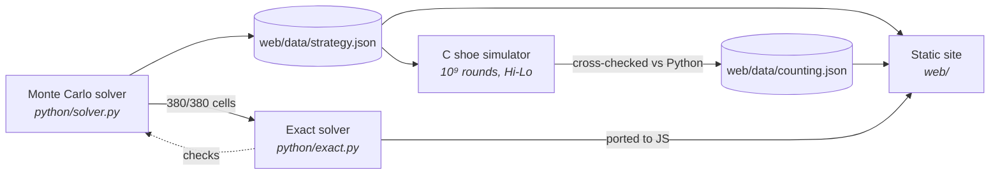

# Beat the Dealer

## Blackjack strategy by Monte Carlo, Hi-Lo card counting and a billion simulated rounds

---

<div align="center">

```
╔══════════════════════════════════════════════════════════════╗
║                                                              ║
║     BEAT THE DEALER                                          ║
║     Monte Carlo strategy solver + Hi-Lo card counting        ║
║                                                              ║
║     Python · C · JavaScript                                  ║
║                                                              ║
╚══════════════════════════════════════════════════════════════╝
```

**Monte Carlo Simulation • Backward Induction • Exact Validation • Card Counting • Risk of Ruin**

**[▶ Play it live: claudialbombin.github.io/beat-the-dealer](https://claudialbombin.github.io/beat-the-dealer/)**

[](https://github.com/claudialbombin/beat-the-dealer/actions/workflows/ci.yml)


[](LICENSE)

</div>


---

## Table of Contents

1. [What Is This Project?](#what-is-this-project)
2. [Try It](#try-it)
3. [Why This Project Exists](#why-this-project-exists)
4. [What You Will Learn](#what-you-will-learn)
5. [Mathematical Background](#mathematical-background)
6. [How It Works](#how-it-works)
7. [Understanding The Output](#understanding-the-output)
8. [Results & Findings](#results--findings)
9. [Rules](#rules)
10. [Installation & Usage](#installation--usage)
11. [Repository Layout](#repository-layout)
12. [Skills Demonstrated](#skills-demonstrated)
13. [Limitations](#limitations)
14. [Frequently Asked Questions](#frequently-asked-questions)
15. [References & Further Reading](#references--further-reading)

---

## What Is This Project?

The project answers two questions about blackjack, and checks every answer it gives.

### 1. What is the optimal way to play each hand?

For every decision (your total, soft or hard, against the dealer's upcard) it simulates every legal action two million times and keeps the one with the highest expected value. The result is the full **basic-strategy chart**: 380 decisions, derived from scratch by Monte Carlo.

### 2. Is that chart right?

It builds a second, independent **exact solver** that computes the same expected values by recursion, without any randomness. The two agree on **all 380 cells**.

### 3. Does card counting actually work, and by how much?

A C simulator plays **one billion rounds** of a real 6-deck shoe with that strategy and the **Hi-Lo count**, and measures what the player can expect at every true count. The answer is yes, but the edge is thin.

| | Result |
|---|---|
| House edge with perfect basic strategy (6 decks, dealer hits soft 17) | **0.696% ± 0.007%** (95% CI, 10⁹ simulated rounds) |
| Monte Carlo chart vs the exact solver | **380 / 380** decisions agree |
| Player edge gained per +1 Hi-Lo true count | **+0.50%** |
| True count where the player gains the edge | **≈ +0.9** |
| Counter's edge with a 1–12 bet spread / leaving at negative counts (1–8) | **+0.19%** / **+0.80%** |

> **The honest conclusion: card counting works, but in this game the edge is thin.** The count predicts the next hand very reliably, but only about a quarter of rounds are dealt at a positive count. With basic strategy alone a 1–8 spread roughly breaks even; beating the game takes a wider spread or leaving the table when the count goes negative.

---

## Try It

<a href="https://claudialbombin.github.io/beat-the-dealer/#play"></a>

<sub>The coach grades every decision against basic strategy. Here it catches a stand on hard 13 vs 10 and shows what it costs: 11.5% of the bet.</sub>

<table>
<tr>
<td width="50%" valign="top">
<a href="https://claudialbombin.github.io/beat-the-dealer/#lab"></a>
<sub><b>Monte Carlo lab.</b> Hard 16 vs 10 simulated live in a Web Worker; the bands close in on the exact EVs (dashed).</sub>
</td>
<td width="50%" valign="top">
<a href="https://claudialbombin.github.io/beat-the-dealer/#strategy"></a>
<sub><b>Strategy chart.</b> Change a rule and the game is re-solved exactly in the browser; the cells that change light up.</sub>
</td>
</tr>
</table>

| Section | What you can do |
|---|---|
| **[Play](https://claudialbombin.github.io/beat-the-dealer/#play)** | A full table: 6-deck shoe with a cut card, splits, doubles, dealer peek. A coach grades every decision and shows the expected-value cost of mistakes. Optional running and true count, count quizzes, and table rules you can change. Keyboard: `H` `S` `D` `P`, `Space` to deal. |
| **[Drill](https://claudialbombin.github.io/beat-the-dealer/#drill)** | Rapid two-card decisions dealt at their real frequencies, with filters for hard, soft, pairs, close calls or your own mistakes, and a mastery map of the chart. |
| **[Strategy chart](https://claudialbombin.github.io/beat-the-dealer/#strategy)** | Hover any cell for the EV of every action (exact, plus the Monte Carlo estimate with its confidence interval). Change a rule (S17, no DAS, 6:5) and the whole game is re-solved in the browser. Colour by "how close is the call". |
| **[Monte Carlo lab](https://claudialbombin.github.io/beat-the-dealer/#lab)** | Pick any decision and simulate it live. Watch the estimates and their 95% bands converge on the exact answer, and turn common random numbers on and off to see the variance reduction. |
| **[Card counting](https://claudialbombin.github.io/beat-the-dealer/#counting)** | EV by true count from the billion-round run, a drag-to-edit betting ramp with edge, variance, N0 and risk of ruin, 200 simulated bankroll paths, and a speed-count drill. |

<details>
<summary><b>📈 Screenshot: the card-counting page</b></summary>
<br>

</details>

---

## Why This Project Exists

### Educational Purpose

Blackjack is a small, fully specified world where you can see every idea of simulation-based decision making at work, and check it against an exact answer. The project covers:

- **Monte Carlo methods:** estimating an unknown expectation by averaging random outcomes, and knowing how far to trust the average.
- **Dynamic programming:** a decision is only as good as the decisions that follow it, so later states are solved first.
- **Variance reduction:** comparing two actions on the same random draws so the comparison costs far fewer samples.
- **Validation:** an exact solver, a published chart and statistical tests stand between the simulation and the claim.
- **Risk:** an edge is not the same as winning; bankroll, variance and risk of ruin decide what an edge is worth.

### Historical Context

In 1962, mathematics professor **Edward O. Thorp** published *Beat the Dealer*, showing with early IBM computers that blackjack can be beaten. Unlike roulette, the game has **memory**: the cards already dealt change the odds of the cards to come, so a player who tracks them can bet more when the remaining shoe favours them. This project recreates both halves of that work (the strategy and the count) with modern simulation, and puts a number and a confidence interval on each result.

---

## What You Will Learn

### Core Concepts

| Concept | Where it appears |
|---|---|
| **Monte Carlo estimation** | Every chart cell is an average over 2,000,000 simulated hands |
| **Standard error, 1/√N** | Each estimate carries its 95% interval; the lab shows the band shrinking live |
| **Backward induction** | States are solved in the order a hit can reach them, so later play is already optimal |
| **Common random numbers** | Actions are compared on shared draws; the paired error is reported per cell |
| **Exact recursion** | An infinite-deck solver computes the true EVs that the simulation must match |
| **Effect of removal** | Why small cards leaving the shoe help the player, and why Hi-Lo tracks it |
| **Weighted regression** | The edge-per-true-count slope is a least-squares fit weighted by sample size |
| **Risk of ruin, N0, Kelly** | What a betting ramp's edge and variance mean for a finite bankroll |

### Practical Skills

| Skill | Use beyond blackjack |
|---|---|
| **Vectorised simulation (NumPy)** | Option pricing, risk models, any embarrassingly parallel Monte Carlo |
| **High-throughput C with independent RNG streams** | Large-scale simulation where Python is too slow |
| **Cross-implementation testing** | Proving two codebases compute the same thing, within sampling error |
| **Interactive teaching tools** | Communicating a quantitative result to people who did not run it |

---

## Mathematical Background

### Expected Value and the Monte Carlo Estimator

The value of an action $a$ in a state $s$ is the expected profit per unit bet, $\mu = \mathbb{E}[X \mid s, a]$. Monte Carlo replaces the expectation with an average over $N$ independent simulated hands:

$$\hat{\mu}_N = \frac{1}{N}\sum_{i=1}^{N} X_i, \qquad \mathrm{SE}(\hat{\mu}_N) = \frac{\sigma}{\sqrt{N}}$$

By the central limit theorem the 95% interval is $\hat{\mu}_N \pm 1.96\,\sigma/\sqrt{N}$. In this game the measured standard deviation of one round is $\sigma \approx 1.15$ units, which sets how much simulation each question needs:

| Hands simulated (N) | 95% half-width | Good enough for |
|---|---|---|
| 10,000 | ±2.26% | Telling a clear decision from a bad one |
| 100,000 | ±0.71% | Most chart cells |
| 2,000,000 | ±0.16% | Every cell except a few near-ties (used for the chart) |
| 1,000,000,000 | ±0.007% | The house edge to three decimal places (used for counting) |

Ten times more precision costs a hundred times more hands. That is why the chart uses the two tricks below instead of brute force.

### Backward Induction

After you hit, the hand goes on, so the value of hitting depends on playing the rest of the hand well. With $p(c)$ the probability of drawing card $c$ and $s \oplus c$ the state it leads to:

$$V(s) = \max\Big(\underbrace{Q(s,\text{stand})}_{\text{dealer plays out}},\; \underbrace{\textstyle\sum_c p(c)\, V(s \oplus c)}_{\text{hit, then play on optimally}},\; \underbrace{2\,Q(s,\text{double})}_{\text{one card, double stake}}\Big)$$

The solver works backwards through the states a hit can lead to (hard 21 → 11, soft 21 → 12, hard 10 → 4), so whenever a simulated hand hits into a later state, the policy for that state is already solved. A solver that simply "hits to 17" after the first decision undervalues hitting, and gets close calls wrong.

### Common Random Numbers

What decides a cell is the *difference* between two actions, and its variance is

$$\mathrm{Var}(\hat{\mu}_a - \hat{\mu}_b) = \mathrm{Var}(\hat{\mu}_a) + \mathrm{Var}(\hat{\mu}_b) - 2\,\mathrm{Cov}(\hat{\mu}_a, \hat{\mu}_b)$$

Playing every action of a state against the **same** dealer hands and the **same** next cards makes the covariance large and positive, so the noise that both estimates share cancels. The difference then reflects the decision, not sampling luck. The [Monte Carlo lab](https://claudialbombin.github.io/beat-the-dealer/#lab) lets you switch this on and off and see how many hands each decision needs.

### The Exact Solver (Infinite Deck)

If the deck is infinite, every draw is independent: each rank from 2 to 9 and the Ace has probability $1/13$, and ten-valued cards have $4/13$. The dealer's final total then follows a recursion over a few hundred states, and every player EV follows from it exactly. The dealer's chance of busting by upcard (hits soft 17) shows why the chart stands on small totals against a weak card:

| Upcard | 2 | 3 | 4 | 5 | 6 | 7 | 8 | 9 | 10 |
|---|---|---|---|---|---|---|---|---|---|
| Dealer busts | 35.7% | 37.7% | 39.7% | 41.8% | 43.9% | 26.2% | 24.5% | 22.8% | 23.0% |

The infinite-deck model is also what makes the Monte Carlo result checkable one-to-one: both solvers use the same card model, so any disagreement would be a bug.

### Hi-Lo Card Counting

Each card seen changes a **running count** (RC):

| Cards | 2 3 4 5 6 | 7 8 9 | 10 J Q K A |
|---|---|---|---|
| Hi-Lo tag | **+1** | 0 | **−1** |

The **true count** normalises it by the size of what is left to deal:

$$\mathrm{TC} = \left\lfloor \frac{\mathrm{RC}}{\text{decks remaining}} \right\rfloor$$

A high true count means the remaining shoe is rich in tens and Aces. That helps the player because blackjacks (paid 3:2) become more likely, doubles win more often, and the dealer, who must hit stiff hands, busts more. In the simulation the hole card is counted only when it is turned over, as a real counter would see it.

### Edge as a Function of the True Count

The billion-round run gives the player's EV in every true-count bin. Over the well-populated bins (−5 to +6) a least-squares line weighted by sample size fits

$$\mathrm{EV}(\mathrm{TC}) \approx -0.43\% + 0.50\% \times \mathrm{TC}$$

so the player breaks even at $\mathrm{TC} = 0.43/0.50 \approx +0.9$. This is the chart at the top of this page.

### Betting Ramps, N0 and Risk of Ruin

A counter bets more at high counts. With $f(t)$ the share of rounds at true count $t$, $b(t)$ the bet and $\mu(t)$ the EV per unit:

$$\text{edge} = \frac{\sum_t f(t)\, b(t)\, \mu(t)}{\sum_t f(t)\, b(t)}, \qquad \mathrm{N0} = \left(\frac{\sigma_{\text{round}}}{\mathbb{E}[\text{profit per round}]}\right)^2$$

**N0** is the number of rounds after which the expected win equals one standard deviation of luck: before that, results are mostly noise. The probability of ever losing a bankroll $B$ (in betting units) uses the standard diffusion approximation:

$$\mathrm{RoR}(B) \approx \exp\!\left(-\frac{2\,\mu\,B}{\sigma^2}\right)$$

The **Kelly** fraction for a single favourable bet is about edge over variance; with roughly 0.5% of edge per true count and a variance near 1.33 per round, that is under 0.4% of the bankroll per point of true count, which is why counters need large bankrolls.

---

## How It Works



### 1. Basic Strategy by Monte Carlo ([`solver.py`](python/src/blackjack/solver.py))

For every decision and every legal action, simulate the rest of the hand N = 2,000,000 times and average the profit, with backward induction and common random numbers as described above. The paired standard error of the difference between actions is reported for every cell. The whole solver is vectorised with NumPy (one state-action is a handful of array operations over N hands) and parallelised across upcards. With 2M hands per action it runs in about two minutes.

### 2. The Exact Reference ([`exact.py`](python/src/blackjack/exact.py))

The infinite-deck recursion computes the true EV of every action in every state. All 380 Monte Carlo cells agree with it, and the Monte Carlo chart's exact EV equals the optimum's (−0.789%).

<details>
<summary><b>🔍 How the validation was done</b></summary>
<br>

- The estimates are unbiased: a test checks the distribution of z-scores against the exact EVs.
- Three cells (11 vs A, 16 vs 10, soft 15 vs 4) are statistical ties at 2M hands, because the two best actions differ by less than 1.96 standard errors. The exact solver confirms the Monte Carlo pick in each.
- The exact solver is checked against the standard dealer bust probabilities and the published 6-deck H17 DAS chart. It matches every cell except soft 13 vs 5, a known card-removal effect: doubling is right in a 6-deck shoe, hitting with an infinite deck.
- The C simulator and the Python reference simulator are run side by side by a test, which checks that they agree within sampling error.

</details>

### 3. The Real Game, a Billion Times ([`C/`](C/src/round.c))

A C11 port of the Python engine plays the finite 6-deck shoe (75% penetration; the round in progress always finishes at the cut card) with the solved strategy and a Hi-Lo count. It runs about 5M rounds/s per thread, with an independent xoshiro256** random stream per thread, and writes per-true-count moments and outcome histograms.

### 4. The Site ([`web/`](web/))

Plain ES modules with no framework and no build step. The exact solver is ported to JavaScript (checked against the Python values to 10⁻⁶), so rule changes re-solve instantly. The Monte Carlo lab runs in a Web Worker, and the charts are a small hand-written SVG layer.

Animations are there to show what just changed: cards slide out of the shoe and only new cards move, the hole card turns over, results and coach feedback pop in, the chart cascades in and flashes the cells a rule change moves, and simulated bankroll paths draw from left to right. All of it is switched off for visitors who set `prefers-reduced-motion`.

---

## Understanding The Output

### Reading the Strategy Chart

| Code | Meaning |
|---|---|
| **H** | Hit |
| **S** | Stand |
| **D** | Double if allowed, otherwise hit |
| **Ds** | Double if allowed, otherwise stand |
| **P** | Split the pair |
| **·** | Don't split: play the pair as a hard or soft total |

### Key Strategy Insights

Exact expected values per unit bet, from the solver (6 decks treated as infinite, dealer hits soft 17):

| Hand | What the chart says | Why |
|---|---|---|
| **Hard 16 vs 10** | Hit, by a hair: −53.98% vs −54.04% for standing | The closest call in the game. Both lose about half the bet; the difference is 0.06%. |
| **Hard 12 vs 2** / **vs 4** | Hit vs 2 (−25.4% vs −28.7%), stand vs 4 (−20.6% vs −21.4%) | A 2 busts the dealer only 35.7% of the time, a 4 nearly 40%. |
| **Hard 11 vs Ace** | Double: +10.34% vs +10.27% for hitting | With the dealer hitting soft 17, doubling edges out hitting. |
| **Soft 18 vs 9** / **vs 6** | Hit vs 9 (−10.1% vs −18.3%), double vs 6 (+35.5% vs +22.3%) | 18 loses to a likely 19; against a weak 6 it is worth doubling. |
| **8,8 vs 10** | Split: −48.95% vs −53.98% for hitting 16 | Splitting turns one bad hand into two mediocre ones, and loses less. |
| **A,A vs 10** | Split: +17.97% vs −7.00% for hitting soft 12 | Two hands starting with an Ace each. |
| **10,10 vs 6** | Never split: stand at +67.8% vs +56.5% for splitting | A 20 already wins most of the time. |

### The Key Graph: EV vs True Count

The chart at the top shows the player's EV in each true-count bin (dots, with 95% intervals), the weighted fit (line) and how often each count occurs (bars). Read it in three zones:

1. **Negative counts (TC ≤ −1): 46.8% of rounds.** The house edge grows to about 2% at TC −3. A counter bets the minimum, or leaves the table ("Wonging out").
2. **Neutral (TC = 0): 26.6% of rounds.** The player is still behind, at −0.45%.
3. **Positive counts (TC ≥ +1): 26.6% of rounds.** The player is ahead from +1 (+0.12%) and gains about half a percent per point: +1.07% at +3, +1.91% at +5. But only 8.3% of rounds are dealt at +3 or more.

That last line is the whole story of card counting: **the signal is reliable, but the good situations are rare**, so the edge depends on how hard you bet when they come.

### Statistical Confidence

With 10⁹ rounds, the overall house edge is known to ±0.007% and every bin from −5 to +6 holds millions of rounds, so the slope of the line is not a matter of luck. The dots' intervals are drawn on the chart; at the edges of the range they widen because those counts are rare.

---

## Results & Findings

### Betting Ramps

What each ramp earns, from the billion-round distribution (bets in units by true count; "Wong out" sits out rounds below 0):

| Ramp | Edge per unit wagered | SD per round (units) | N0 (rounds) | Bankroll for 5% risk of ruin |
|---|---|---|---|---|
| Flat bet | −0.696% | 1.15 | never (negative edge) | no bankroll is enough |
| 1–4 | −0.239% | 1.68 | never | no bankroll is enough |
| 1–8 | +0.025% | 2.29 | ~41 million | ~21,900 units |
| 1–12 | +0.185% | 2.81 | ~920,000 | ~4,000 units |
| Wong out, 1–8 | +0.804% | 2.15 | ~73,000 | ~870 units |

### Key Findings

- **Basic strategy alone leaves a 0.696% house edge** in this game (6 decks, H17, DAS, 3:2).
- **A 1–8 spread barely breaks even** (+0.025%); its N0 of about 41 million rounds means the edge would take years of full-time play to show through the noise.
- **Spread matters more than skill once the count is right:** going from 1–8 to 1–12 multiplies the edge by seven.
- **Not playing bad counts is the strongest lever:** leaving at negative counts with a 1–8 ramp gives +0.80%, the best result here, with a tenth of the bankroll the 1–12 ramp needs.

### Performance

| Component | Throughput |
|---|---|
| Monte Carlo chart, 2M hands per action, NumPy | about 2 minutes for the whole chart |
| C shoe simulator | about 5M rounds per second per thread |
| Exact solver in the browser | re-solves the full chart instantly on a rule change |

---

## Rules

6 decks · dealer hits soft 17 · blackjack pays 3:2 · double on any two cards · double after split · one split per hand, split Aces receive one card · dealer peeks for blackjack · no surrender · no insurance · 75% penetration.

---

## Installation & Usage

```bash
# Python: solver, exact reference, reference simulator (numpy only)
cd python
pip install -e ".[dev]"
pytest -q                                   # 43 tests
python -m blackjack chart                   # print the exact chart
python -m blackjack solve --n 2000000       # Monte Carlo chart -> web/data/strategy.{json,csv}

# C: the billion-round counting simulation
cd ../C
make test                                   # unit tests
./bin/bjsim --rounds 1000000000 --threads 8 --out ../results/counting_c.csv
cd ../python && python -m blackjack count --from-c ../results/counting_c.csv --write

# Web: static, serve the folder
cd ../web
npm test                                    # engine, exact solver and MC worker tests
python3 -m http.server 8000                 # open http://localhost:8000

# README chart, rebuilt from web/data/counting.json
cd .. && python3 docs/make_hero_svg.py
```

The committed data (`web/data/`, `results/`) comes from exactly these commands: seed 2026, 2M hands per action for the chart and 10⁹ rounds for counting.

---

## Repository Layout

```
python/src/blackjack/   cards, rules, engine (finite shoe), exact.py, solver.py, counting.py, cli.py
python/tests/           rules edge cases, solver validation, C cross-check
C/                      bjsim: include/bj.h, src/{rng,cards,strategy,round,main}.c, tests/
web/                    index.html, css/, js/ (engine, exact, charts, views/, mc-worker.js), data/, tests/
results/                raw output of the C run
docs/                   README images and make_hero_svg.py, which draws the chart at the top
.github/workflows/      CI (C, Python, JS tests) and GitHub Pages deployment
```

### Three Implementations, One Game

| | Python | C | JavaScript |
|---|---|---|---|
| **Role** | Solvers and the reference engine | The billion-round shoe simulation | The interactive site |
| **Why this language** | NumPy vectorisation, readable maths | Raw speed and multithreading | Runs in every browser, no install |
| **Checked against** | The exact solver and a published chart | The Python engine, within sampling error | The Python values, to 10⁻⁶ |

---

## Skills Demonstrated

### Technical Skills

- **Monte Carlo methods:** estimation with confidence intervals, convergence, common random numbers.
- **Dynamic programming:** backward induction for the simulated policy; exact recursion for the reference.
- **Statistics:** z-score tests for unbiasedness, weighted regression, sampling-error cross-checks between implementations.
- **Risk analysis:** edge, variance, N0, risk of ruin and Kelly sizing for betting ramps.
- **Performance:** vectorised NumPy, multithreaded C11 with independent xoshiro256** streams, a Web Worker for in-browser simulation.

### Software Engineering Practices

- **Three implementations that test each other**, with CI running the C, Python and JavaScript suites on every push.
- **Reproducible results:** fixed seeds, and every committed number is produced by a command in this README.
- **No build step** for the site, and a GitHub Pages deployment workflow.
- **Accessibility:** keyboard play, labelled controls and reduced-motion support.

---

## Limitations

- **Basic strategy only.** The counter never deviates from the chart. Count-based index plays (the "Illustrious 18") are worth roughly another 0.1–0.2%.
- **Infinite-deck strategy.** The chart and the coach's EV figures use the infinite-deck model. The shoe simulation is exact for 6 decks.
- **Rules not modelled:** surrender, re-splitting and insurance.
- **Bankroll paths are a teaching tool.** They draw rounds independently from the simulated (true count, outcome) distribution, which ignores how counts persist within a shoe. Risk of ruin uses the standard diffusion approximation.

This is an educational project about simulation and decision-making under uncertainty, not gambling advice.

---

## Frequently Asked Questions

### Does this actually work in real casinos?

The mathematics does, but the margin is small. Under these rules, a 1–8 spread barely breaks even and the best ramp here earns under 1% of what you bet, with swings that take hundreds of thousands of rounds to average out. Many casinos also use rules that cut the edge further (paying 6:5 instead of 3:2 for a blackjack costs the player about 1.35%, which you can check in the strategy chart), shuffle early, or ask counters to leave.

### Why Python, C and JavaScript?

Each does one job well. Python with NumPy keeps the solvers short and readable. C runs the billion-round simulation in minutes instead of hours. JavaScript puts everything in the browser, so anyone can play and experiment without installing anything. Having three versions also means each one checks the others.

### How accurate are the results?

Every simulated number comes with a 95% confidence interval. The house edge is 0.696% ± 0.007%, and the strategy chart is confirmed cell by cell by an exact solver. The main modelling approximation is the infinite-deck chart; the Limitations section lists the rest.

### How long does it take to run?

The Monte Carlo chart takes about two minutes. The C simulator runs about 5 million rounds per second per thread, so a billion rounds takes under a minute on an 8-thread machine. The tests run in well under a minute.

### Can I try different rules?

Yes. In the [strategy chart](https://claudialbombin.github.io/beat-the-dealer/#strategy) you can switch soft 17, double after split and the blackjack payout, and the exact solver re-solves the whole game instantly, outlining the cells that change.

---

## References & Further Reading

### Foundational Works

- E. O. Thorp, *Beat the Dealer* (1962): the first computer-derived basic strategy and card-counting system.
- P. A. Griffin, *The Theory of Blackjack*: card-removal effects and counting-system analysis.
- D. Schlesinger, *Blackjack Attack*: risk of ruin, N0, betting ramps and the Illustrious 18.

### Monte Carlo Methods

- P. Glasserman, *Monte Carlo Methods in Financial Engineering*: variance reduction, including common random numbers.

---

## License

[MIT](LICENSE) © Claudia María López Bombín
